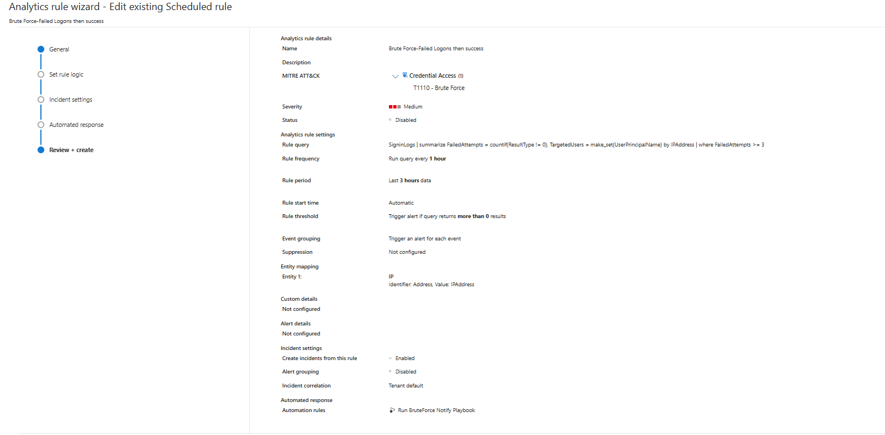
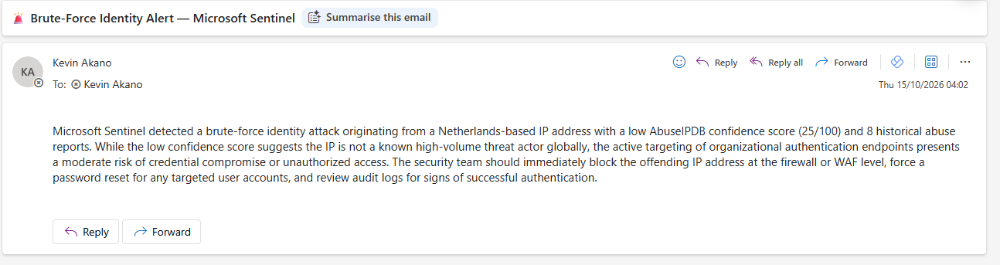

# SOC SOAR Capstone: Automated Detection & Response for a Midnight Blizzard-Style Campaign

**A live SOC that detects a five-stage, nation-state-style attack — and responds to every stage automatically**, enriching each incident with threat intel and an AI-written summary before a human ever opens it.

**Skills demonstrated:** Detection Engineering (KQL) · Security Automation / SOAR (Logic Apps) · AI-Assisted Triage (Gemini) · Threat-Intel Enrichment (AbuseIPDB) · Incident Response · Campaign Correlation · MITRE ATT&CK · Microsoft Sentinel · Defender XDR · Entra ID / Conditional Access

**Stack:** Microsoft Sentinel · KQL · Azure Logic Apps · Defender XDR · Entra ID P2 · AbuseIPDB · Google Gemini

---

## The problem

In **January 2024, Microsoft** disclosed that **Midnight Blizzard (APT29)** breached its corporate environment using a **password spray** to compromise a legacy account, then a **malicious OAuth consent** to gain persistent mailbox access that survived password resets and MFA. [1]

The lesson: **identity is the perimeter, and detection alone isn't enough.** A real SOC drowns in alerts, and manual tier-1 triage is the first thing to fall behind. This project closes that gap — not *"can I detect it?"* but *"can I detect it **and** respond automatically, across the whole kill chain?"*

| Real-world failure | What this project builds |
|---|---|
| Alerts fire faster than analysts can triage | SOAR playbooks that auto-enrich and summarise every incident |
| First 10 minutes wasted gathering context | AbuseIPDB + Gemini enrichment delivered *before* a human looks |
| Five alerts hide one coordinated campaign | A Workbook correlating all stages into one timeline |
| Detections look clean in a demo, flood in prod | Threshold tuning, entity mapping, suppression |
| OAuth/token persistence survives a password reset | Response guidance that revokes grants, not just passwords |

---

## How it works — the five-stage loop

Every attack follows the same pipeline:

```
Attack → Hunt (KQL) → Detect (Sentinel rule, MITRE-mapped) → Automate (playbook: enrich → AI-summarise → notify) → Correlate (dashboard)
```

| Layer | Tech |
|---|---|
| SIEM / SOAR | Microsoft Sentinel + Azure Logic Apps |
| Telemetry | Defender XDR (Endpoint, O365), Entra sign-in & audit logs |
| Enrichment | AbuseIPDB (IP reputation) · Gemini `gemini-2.0-flash` (AI summaries) |

---

## The five attacks

Each has a MITRE-mapped detection rule and a dedicated SOAR playbook.

### 1 · Identity Brute Force — `T1110`
Repeated failed logins from one source IP (the password-spray stage). **The only playbook that adds external threat intel** — it queries AbuseIPDB on the offending IP and feeds the reputation into the AI summary.
```kql
SigninLogs
| summarize FailedAttempts = countif(ResultType != 0), TargetedUsers = make_set(UserPrincipalName) by IPAddress
| where FailedAttempts >= 3
```
*Severity: Medium · Entity: IP → IPAddress · Response: `PB-Identity-BruteForce-Notify` (AbuseIPDB + Gemini)*





### 2 · OAuth Consent Persistence — `T1098.003`
A third-party app granted `Mail.Read` — a token that survives password resets and MFA, exactly as Midnight Blizzard used.
```kql
AuditLogs
| where OperationName has_any ("Consent to application", "Add delegated permission grant", "Add app role assignment")
| extend AccountUPN = tostring(InitiatedBy.user.userPrincipalName), TargetApp = tostring(TargetResources[0].displayName)
| project TimeGenerated, OperationName, AccountUPN, TargetApp
```
*Severity: High · Entity: Account → AccountUPN · Response: `PB-OAuth-Consent-Notify`*

<!-- IMAGE (rule-oauth.png): OAuth rule review page --> 
<!-- IMAGE (email-oauth.png): OAuth alert email --> 

### 3 · Privilege Escalation — `T1098.003`
A privileged Entra role (Helpdesk Administrator) assigned to an account. `coalesce(TargetUser, Actor)` guarantees a non-null entity so enrichment never skips.
```kql
AuditLogs
| where OperationName contains "Add member to role"
| extend Actor = tostring(InitiatedBy.user.userPrincipalName), TargetUser = tostring(TargetResources[0].userPrincipalName)
| extend AccountForEntity = coalesce(TargetUser, Actor)
| project TimeGenerated, OperationName, Actor, TargetUser, AccountForEntity
```
*Severity: High · Entity: Account → AccountForEntity · Response: `PB-PrivEsc-Notify`*

<!-- IMAGE (rule-privesc.png): PrivEsc rule review page --> 
<!-- IMAGE (email-privesc.png): PrivEsc alert email --> 

### 4 · Endpoint Execution (Encoded PowerShell) — `T1059.001` · `T1027`
Base64-encoded PowerShell on an onboarded host — the highest-confidence, lowest-false-positive signal in the campaign (encoded PowerShell is rare when benign).
```kql
DeviceProcessEvents
| where ProcessCommandLine has "EncodedCommand"
| project TimeGenerated, DeviceName, AccountName, ProcessCommandLine
```
*Severity: Medium · Entity: Host → DeviceName · 5-min run, 1-hr lookback, suppression on · Response: `PB-Endpoint-Notify`*

<!-- IMAGE (rule-endpoint.png): Endpoint rule review page --> 
<!-- IMAGE (email-endpoint.png): Endpoint alert email --> 

### 5 · Phishing → Conditional Access Block — `T1566`
A phishing simulation; when a user clicked and authenticated, **Conditional Access blocked the sign-in** from the non-compliant device (`ResultType 53000`) — layered defence catching what the user missed.
```kql
SigninLogs
| where ResultType == 53000
| project TimeGenerated, UserPrincipalName, AppDisplayName, IPAddress, ResultType, ConditionalAccessStatus
```
*Severity: Medium · Entity: Account → UserPrincipalName · Response: `PB-Phishing-Notify`*

<!-- IMAGE (rule-phishing.png): Phishing rule review page --> 
<!-- IMAGE (email-phishing.png): Phishing alert email --> 

---

## The SOAR pipeline

Each detection raises an incident → an automation rule fires a Logic App playbook. The brute-force playbook shows the full pattern:

```
Sentinel incident → Get IPs → For each: AbuseIPDB (reputation) → Gemini (3–4 sentence SOC brief) → email the SOC
```

<!-- IMAGE (playbook-designer.png): Logic App designer for PB-Identity-BruteForce-Notify --> 
<!-- IMAGE (playbooks-list.png): Playbooks list --> 
<!-- IMAGE (automation-rules.png): Automation rules list --> 

> **Playbook = *what* runs. Automation rule = *when* it runs** (one firing per new incident).

---

## Campaign dashboard

One Sentinel Workbook correlates all five attacks — the view no single incident can give.

<!-- IMAGE (dashboard-full.png): Workbook correlation table --> 
<!-- IMAGE (dashboard-bar.png): Detections by attack bar chart --> 
<!-- IMAGE (dashboard-timeline-mitre.png): Timeline + MITRE grid --> 

| Tactic | Technique | Attack |
|---|---|---|
| Credential Access | T1110 Brute Force | Identity brute force |
| Persistence | T1098.003 Additional Cloud Roles | OAuth consent |
| Privilege Escalation | T1098.003 Account Manipulation | Role assignment |
| Execution / Defense Evasion | T1059.001 / T1027 | Encoded PowerShell |
| Initial Access | T1566 Phishing | Phishing (CA block) |

---

## Key design decisions (what tutorials skip)

- **Entity mapping is mandatory** — an incident with no mapped entity runs the playbook but enriches nothing. Attack 3's `coalesce()` exists to guarantee one.
- **Match lookback to frequency + suppress, or detections flood** — a lookback longer than the run interval re-alerts on the same event every cycle.
- **CA failures masquerade as brute force** — phishing-induced CA blocks (`53000`) register as failed sign-ins, so the campaign query separates them explicitly.
- **Defender tables aren't in Sentinel by default** — `DeviceProcessEvents`/`EmailEvents` must be streamed in via the Defender XDR connector, and streaming never backfills.
- **Pin a current AI model** — retired Gemini versions return `404`; free-tier quota returns `429`, so the cadence is throttled and the model pinned.

## Future improvements

Automated containment gated by analyst approval (disable account, revoke sessions/grants, isolate host) · a scheduled campaign-digest playbook · threat-intel enrichment across all playbooks · ServiceNow/Jira ticketing instead of email.

---

## References

1. Microsoft Security Response Center — [Midnight Blizzard: guidance for responders](https://msrc.microsoft.com/blog/2024/01/microsoft-actions-following-attack-by-nation-state-actor-midnight-blizzard/) (January 2024).

*Personal hands-on lab by Kevin Akano. Tenant, company name, and user personas are fictional.*
